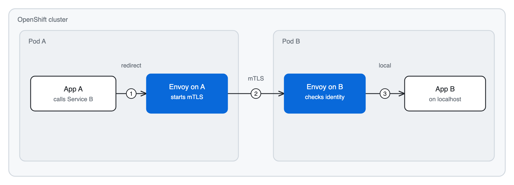
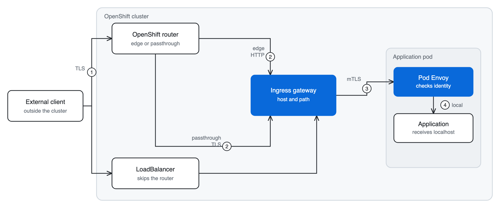
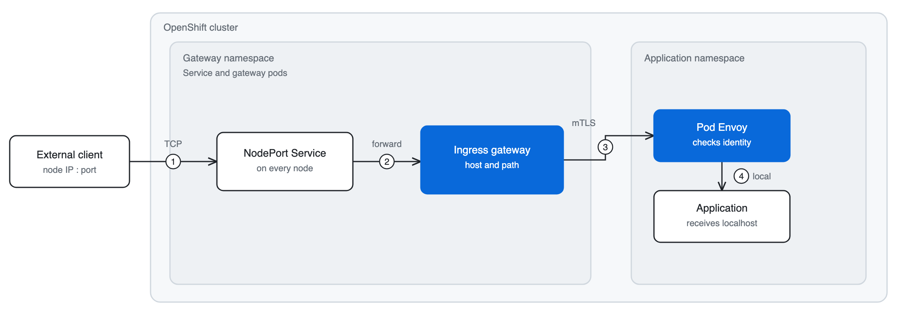

# OpenShift Service Mesh traffic flow

Blue boxes are Envoy proxies. White boxes are applications and the OpenShift entry points. The response returns through the same proxies.

This repository has two sections.

1. [East-west traffic](#1-east-west-traffic) is a call from one meshed service to another inside the cluster.
2. [External to internal traffic](#2-external-to-internal-traffic) is a request from outside the cluster. It enters through a route, a LoadBalancer, or a NodePort, reaches the ingress gateway, and then follows the east-west path.

## 1. East-west traffic

A call from one meshed service to another stays inside the cluster. It passes through an Envoy on each side.



### Hops

| Hop | From | To | What happens |
| --- | --- | --- | --- |
| 1 | App A | Envoy on A | Call to Service B, redirected to the local proxy |
| 2 | Envoy on A | Envoy on B | mTLS to the selected pod |
| 3 | Envoy on B | App B | Forward on localhost |

App A calls the Kubernetes Service by cluster DNS, such as `http://reviews:9080`. That Service lives in the application namespace. On OpenShift the Istio CNI plugin redirects outbound TCP to Envoy’s outbound listener (`15001`). Envoy on A still sees the original destination, applies any `VirtualService` or `DestinationRule`, and connects to a ready pod IP. On pod B, inbound traffic is redirected to Envoy’s inbound listener (`15006`). That proxy checks `AuthorizationPolicy` and forwards to the application on `127.0.0.1`.

`istiod` configures both proxies with routes, endpoints, and policy before the request is sent.

## 2. External to internal traffic

A request from outside the cluster reaches an ingress gateway, then uses the east-west path from hop 3 of the diagrams below. Three entries reach that gateway: an OpenShift route, a LoadBalancer Service, and a NodePort Service.

### 2.1 Route: edge and passthrough



| Hop | From | To | What happens |
| --- | --- | --- | --- |
| 1 | External client | Router or LoadBalancer | TLS to the published host |
| 2 edge | OpenShift router | Ingress gateway | TLS ends at the router, and HTTP is forwarded |
| 2 passthrough | OpenShift router | Ingress gateway | Router forwards TLS, and the gateway decrypts it |
| 3 | Ingress gateway | Pod Envoy | Match host and path, then mTLS to a selected pod |
| 4 | Pod Envoy | Application | Forward the request on localhost |

An edge route sets `termination: edge`. Client TLS ends on the router. A passthrough route sets `termination: passthrough`. The router uses SNI to select the route and forwards the TLS connection unchanged, and the ingress gateway decrypts it. A LoadBalancer Service uses hop 1 and then joins at the gateway, so hop 2 does not run.

### 2.2 LoadBalancer

The LoadBalancer in the diagram above is a Kubernetes Service with `spec.type` set to `LoadBalancer`. It is the ingress gateway Service, in the gateway namespace.

The platform assigns that Service an external address: a cloud load balancer on AWS, Azure, or GCP, or MetalLB on bare metal. Kubernetes also allocates a NodePort for the Service. The platform load balancer sends traffic to that node port, and the node forwards it to a gateway pod. [Section 2.3](#23-nodeport) shows that hop.

The gateway Service usually starts as `ClusterIP` when a `Route` publishes it. Switch the type when you want the external address:

```bash
oc patch service <gateway-name> -n <gateway-namespace> -p '{"spec":{"type":"LoadBalancer"}}'
```

After the request reaches a gateway pod, that Envoy still chooses an application pod. That choice is the proxy’s load-balancing policy, and it is separate from this Service.

A `LoadBalancer` Service reaches the gateway directly, so client TLS ends at the gateway. An edge route ends client TLS at the router. A passthrough route ends client TLS at the gateway. In each case the gateway starts mesh mutual TLS toward the application.

### 2.3 NodePort

A NodePort Service opens one port on every node and forwards connections on that port to the ingress gateway pods. The client connects to a node IP directly.

The Service object lives in the **gateway namespace**, next to the ingress gateway pods. The application namespace holds the application and its own Service, which stays a ClusterIP for east-west calls.



| Hop | From | To | What happens |
| --- | --- | --- | --- |
| 1 | External client | NodePort Service | TCP to any node IP and the allocated high port |
| 2 | NodePort Service | Ingress gateway | Same namespace. OVN-Kubernetes forwards to a gateway pod |
| 3 | Ingress gateway | Pod Envoy | Crosses into the application namespace, then mTLS |
| 4 | Pod Envoy | Application | Forward the request on localhost |

| Object | Namespace |
| --- | --- |
| NodePort, LoadBalancer, or ClusterIP Service for the gateway | Gateway namespace, with the gateway pods |
| Ingress gateway pods | Gateway namespace |
| Application Deployment and its Service | Application namespace |

In Service Mesh 2 the control plane deploys the ingress gateway in its own namespace, usually `istio-system`. The NodePort Service is there. In Service Mesh 3 you choose the gateway namespace when you install the gateway. A dedicated gateway namespace is the usual choice. The Service is in the application namespace only when the gateway pods are installed there.

Kubernetes allocates a port in `30000`–`32767` on every node unless you set `nodePort` yourself. The client connects to `<node-ip>:<nodePort>`. OpenShift uses OVN-Kubernetes to match that port and send the connection to one ready gateway pod, on the Service target port. Istio’s gateway usually listens on `8080` for HTTP and `8443` for HTTPS.

```bash
oc patch service <gateway-name> -n <gateway-namespace> -p '{"spec":{"type":"NodePort"}}'
```

With `externalTrafficPolicy: Cluster`, the default, any node accepts the port and can forward to a gateway pod on another node. With `externalTrafficPolicy: Local`, only a node that runs a gateway pod accepts the connection, and the client source address is preserved.

### 2.4 Gateway APIs

Configure the gateway with either of these APIs:

- Istio `Gateway` and `VirtualService`, using a gateway installed by gateway injection. This fits sidecar meshes.
- Kubernetes Gateway API `Gateway` and `HTTPRoute`. This is the ingress API to use with ambient mode, and it also works with sidecars.

In Service Mesh 3 the gateway is separate from the control plane. Deploy it in its own namespace. Create the OpenShift `Route` yourself. The route host must match the host on the gateway.

## References

- [Getting traffic into a mesh](https://docs.redhat.com/en/documentation/red_hat_openshift_service_mesh/3.5/html/gateways/ossm-getting-traffic-into-a-mesh) (OpenShift Service Mesh 3.5)
